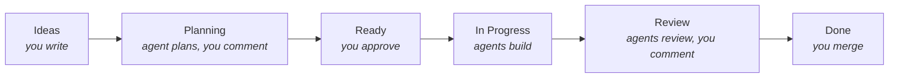

# kanbot

Run an autonomous dev team from a GitHub Project board. You define, specify and prioritize work while Claude or Codex agents work as your team.
Uses subscriptions for Claude or Codex, and does not require API usage. The agents are fully autonomous, but you can comment on their work and steer them as needed.



Full docs: [docs/](./docs/00-index.md). Demo video: [docs/assets/demo.mp4](./docs/assets/demo.mp4).

## How it works

| Column          | What happens                                                                                                                                     |
| --------------- | ------------------------------------------------------------------------------------------------------------------------------------------------ |
| **Ideas**       | Backlog of ideas and tasks. Not touched by any agents.                                                                                           |
| **Planning**    | An agent writes a plan into the issue. Comment to revise it.                                                                                     |
| **Ready**       | Moving a card here approves the plan. Cards are picked top-down.                                                                                 |
| **In Progress** | An agent implements it in its own worktree and opens a PR.                                                                                       |
| **Review**      | Two agent reviews, with fixes. Then you're notified. Comment on the PR and an agent addresses it. CI failures and merge conflicts are fixed too. |
| **Done**        | You merge, or approve and kanbot merges ([`merge.onApproval`](./docs/12-identity.md#merge-on-approval)).                                         |

A Bun daemon polls the board and runs one `claude -p` / `codex exec` process per job. GitHub is the only state, so you can restart it any time. Agents never get a GitHub token; the daemon makes every comment, push and PR. Only collaborators with write access can steer agents.

kanbot talks as you by default. Run `kanbot app create` to have it talk as its own bot instead, so you can tell its messages apart and approve its PRs. Commits stay yours. With `merge.onApproval`, approving a PR merges it. [More](./docs/12-identity.md)

## Setup

Requires [Bun](https://bun.sh) ≥ 1.3, `gh` logged in, and `claude` or `codex` logged in.

```sh
gh auth refresh -s project
cd your-repo
bunx kanbot init --provider claude   # or codex
kanbot board create                  # then enable the built-in workflows it prints
git add -A && git commit -m "chore: add kanbot" && git push
kanbot doctor
kanbot run
```

Use `kanbot run --once --dry-run` to see what it would do. Run one daemon per repo.

For a guided setup, run `bunx kanbot skills install` and ask your agent "help me set up kanbot".

## Labels

| Label                                 | Meaning                                           |
| ------------------------------------- | ------------------------------------------------- |
| `technical`                           | Plan as a technical goal, not a user story        |
| `type:frontend\|backend\|docs\|infra` | Picks the implementer agent (the planner sets it) |
| `explore:2..4`                        | Build N alternative approaches as N PRs           |
| `agent-reviewed`                      | Passed agent review; ready for you                |
| `needs-human`                         | Agents gave up. Remove it to retry.               |
| `kanbot-review`                       | Agent review for your own PR, without a card      |

## Beyond the board

- **Capture ideas by chatting.** Ask your agent to file an idea; the `kanbot-idea` skill shapes it and puts it in Ideas. [More](./docs/03-capturing-ideas.md)
- **Your own PRs.** Label a PR `kanbot-review` for agent review without a card. Commits to `main` that break kanbot PRs get merged in and fixed. [More](./docs/04-outside-the-board.md)
- **Project memory.** Corrections you give on PRs become facts agents read on every job. [More](./docs/06-skills.md#project-memory)
- **Copilot review.** Optionally add GitHub Copilot as a cloud reviewer. [More](./docs/09-copilot-review.md)

## Customizing

- `.kanbot/config.yml`: concurrency, timeouts, notifications, column names.
- `.kanbot/agents/*.md`: agent definitions. Run `kanbot sync` after editing; don't edit the generated `.claude/` or `.codex/` files.
- `.agents/skills/`: skills shared by agents. Fill in `project-conventions` first.

## Upgrading

`bunx kanbot@latest upgrade` updates agents and skills you haven't edited. For edited ones, it writes the new version next to yours as `<file>.kanbot-new` to merge. See [Upgrading](./docs/10-upgrading.md).

## Shell completion

```sh
echo 'source <(kanbot completion)' >> ~/.zshrc     # or ~/.bashrc
kanbot completion --shell fish > ~/.config/fish/completions/kanbot.fish
```

The shell is detected from `$SHELL`; pass `--shell zsh|bash|fish` to override. For zsh, `compinit` must run first.

## Operating

- `kanbot status` shows the board, daemon and failures.
- `.kanbot/logs/*.jsonl` has every agent transcript.

## Limitations

- Ready-column order is the project's manual item order, not a view's sort.
- Workers run as your user. `gh` and `git push` are blocked by command patterns, not missing credentials, so a determined prompt injection could get around them.

## Development

```sh
pnpm install
bun test
pnpm check
pnpm typecheck
```

Commits follow [Conventional Commits](https://www.conventionalcommits.org). A `commit-msg` hook and CI lint them.

### Releasing

1. Merge or push conventional commits to `main`.
2. A draft release updates with the next version and notes. `feat` bumps minor, `fix` patch. On 0.x, breaking changes bump minor.
3. Publish the draft on GitHub. This tags the commit, publishes to npm with provenance, and commits the version to `package.json` on `main`.

Docs: [kanbot.mib.im](https://kanbot.mib.im) shows the latest release, [kanbot.mib.im/main](https://kanbot.mib.im/main/) shows `main`. Both deploy on every push to `main` and on each release. `pnpm docs:dev` serves your working tree.

Preview the next release with `pnpm release:preview`. Mark the draft as a pre-release to publish under the `next` tag.
