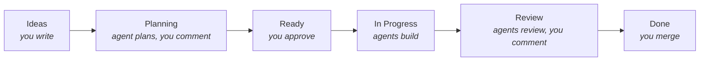

# kanbot

Run an autonomous dev team from a GitHub Project board. You define, specify and prioritize work while Claude or Codex agents work as your team.
Uses subscriptions for Claude or Codex, and does not require API usage. The agents are fully autonomous, but you can comment on their work and steer them as needed.



Full docs: [docs/](./docs/00-index.md).

## How it works

| Column          | What happens                                                                                                                 |
| --------------- | ---------------------------------------------------------------------------------------------------------------------------- |
| **Ideas**       | Backlog of ideas and tasks. Not touched by any agents.                                                                       |
| **Planning**    | An agent writes a plan into the issue. Comment to revise it.                                                                 |
| **Ready**       | Moving a card here approves the plan. Cards are picked top-down.                                                             |
| **In Progress** | An agent implements it in its own worktree and opens a PR.                                                                   |
| **Review**      | Two agent reviews, with fixes. Then you're notified. Comment on the PR and an agent addresses it. CI failures are fixed too. |
| **Done**        | You merge.                                                                                                                   |

A Bun daemon polls the board and runs one `claude -p` / `codex exec` process per job. GitHub is the only state, so you can restart it any time. Agents never get a GitHub token; the daemon makes every comment, push and PR. Only collaborators with write access can steer agents.

## Setup

Requires [Bun](https://bun.sh) ≥ 1.3, `gh` logged in, and `claude` or `codex` logged in.

```sh
gh auth refresh -s project
cd your-repo
bunx kanbot init --provider claude   # or codex
kanbot board create                  # then enable the built-in workflows it prints
git add -A && git commit -m "chore: add kanbot" && git push
kanbot doctor
kanbot run
```

Use `kanbot run --once --dry-run` to see what it would do. Run one daemon per repo.

## Labels

| Label                                 | Meaning                                           |
| ------------------------------------- | ------------------------------------------------- |
| `technical`                           | Plan as a technical goal, not a user story        |
| `type:frontend\|backend\|docs\|infra` | Picks the implementer agent (the planner sets it) |
| `explore:2..4`                        | Build N alternative approaches as N PRs           |
| `agent-reviewed`                      | Passed agent review; ready for you                |
| `needs-human`                         | Agents gave up. Remove it to retry.               |

## Customizing

- `.kanbot/config.yml`: concurrency, timeouts, notifications, column names.
- `.kanbot/agents/*.md`: agent definitions. Run `kanbot sync` after editing; don't edit the generated `.claude/` or `.codex/` files.
- `.agents/skills/`: skills shared by agents. Fill in `project-conventions` first.

## Shell completion

```sh
echo 'source <(kanbot completion)' >> ~/.zshrc     # or ~/.bashrc
kanbot completion --shell fish > ~/.config/fish/completions/kanbot.fish
```

The shell is detected from `$SHELL`; pass `--shell zsh|bash|fish` to override. For zsh, `compinit` must run first.

## Operating

- `kanbot status` shows the board, daemon and failures.
- `.kanbot/logs/*.jsonl` has every agent transcript.

## Limitations

- Ready-column order is the project's manual item order, not a view's sort.
- Workers run as your user. `gh` and `git push` are blocked by command patterns, not missing credentials, so a determined prompt injection could get around them.

## Development

```sh
pnpm install
bun test
pnpm check
pnpm typecheck
```
