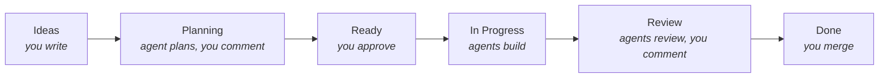

---

title: Development flow
description: How issues move across the board and where you step in.
slug: workflow
---

# Development flow

You decide what gets built and what ships. Agents plan, build, review and fix everything in between.

## 1. Ideas

Add issues in the **Ideas** column, using the **User need** or **Technical task** template. Or talk the idea through with your agent and let it file the issue. See [Capturing ideas](./03-capturing-ideas.md). Nothing runs here.

## 2. Planning

Move a card here to get a plan. The `planner` writes the plan into the issue body: user story, acceptance criteria, and the assumptions it rests on about user need and business value. Risky assumptions become open questions for you.

Comment on the issue to steer it. Each round, the planner answers every new comment and updates the plan. It can also split work into new issues or sub-issues when you ask. Split slices are linked as [blocked by](https://docs.github.com/en/issues/tracking-your-work-with-issues/using-issues/creating-issue-dependencies) the slice before, so they are built in order.

## 3. Ready

Moving a card to Ready approves the plan. Cards are picked top-down, in the project's manual item order, not a view's sort.

A plan with open questions doesn't start. kanbot comments once; move the card back to Planning and answer them, or remove them from the plan.

A card that is blocked by open issues waits, and the next card is picked. kanbot comments once and starts it when the blockers close. Remove the link on the issue to start it anyway.

With [`wip.awaitingHuman`](./10-configuration.md#wip-limit) set, no new card starts while that many items wait on you. Started work runs on.

## 4. In Progress

The `implementer` builds the plan on branch `kanbot/<issue>` in its own worktree, using your repo's skills and [capabilities](./05-capabilities.md). It commits, and the daemon opens a PR. When all PRs are open, the card moves to Review.

If the agent reports it is blocked, you get a notification.

## 5. Review

Each PR goes through, in order:

1. **Your feedback.** Comments and review threads from you are handled first, by the `fixer`.
2. **Merge conflicts.** If the base branch moved and the PR no longer merges, the `fixer` merges the base branch in and resolves the conflicts. It merges rather than rebases, so the PR's history is never rewritten. This runs even after a PR is `agent-reviewed`. It tries up to 3 times. Then the issue gets `needs-human`.
3. **Failing CI.** The `fixer` tries up to 3 times. Then the issue gets `needs-human`.
4. **Technical review** by `reviewer`, through your `review` capability, then a fix if it found problems.
5. **Acceptance review** by `acceptance-reviewer`: every criterion has evidence, required capabilities were used, nothing out of scope. Then a fix if it found problems.
6. **Copilot review**, if you turned it on. The `fixer` answers its comments. See [Copilot review](./13-copilot-review.md).

Nits don't trigger a fix. When all passes are clean, the PR gets `agent-reviewed` and you get a "Ready to test" notification.

Comment on the PR or start a review thread any time. An agent answers and pushes a fix.

To get the same review on a PR you opened yourself, label it `kanbot-review`. See [Working outside the board](./04-outside-the-board.md).

## 6. Done

You test and merge. The board's built-in workflow moves the card to Done, and kanbot cleans up worktrees.

With [`merge.onApproval`](./12-identity.md#merge-on-approval), approving the PR is enough, and kanbot merges it as you. To approve your own kanbot PRs, kanbot must open them as its own app ([app mode](./12-identity.md#app-mode)).

## Exploring alternatives

Add `explore:2`, `explore:3` or `explore:4` to an issue before planning. The plan then has N approaches, and N agents build them as N PRs (`kanbot/<issue>-v<k>`). When all are agent-reviewed, kanbot posts a comparison and notifies you. Merge one; a GitHub workflow closes the others.

## When agents give up

A job that fails `maxAttempts` times (default 2) labels the issue `needs-human`. Failing CI and merge conflicts have their own limit of 3 fix attempts per PR. Fix the cause, then remove the label to retry.

## Who can steer

Only collaborators with write access can steer agents. Comments from others are ignored.

## Safety

> **Warning: use at your own risk.** Agents run unattended, with no sandbox, as your user. They can read and change anything your user can, including files outside the repo, and they act on text from issues and comments. The blocks below make mistakes less likely, but they don't stop a determined prompt injection. This is a current limitation. Run kanbot on a machine or account with nothing you can't afford to lose or leak.

- Agents never get a GitHub token. The daemon makes every comment, push and PR.
- `gh`, `git push`, `git remote` and `git config` are denied for Claude agents.
- For all agents, `gh` sees no login and `git push` fails: kanbot points `GH_CONFIG_DIR` at an empty folder and rewrites push URLs to a dead one.
- GitHub is the only state. You can stop and restart the daemon any time.

Workers run as your user, without a sandbox, and these blocks live in their environment and deny patterns, not missing credentials. In [app mode](./12-identity.md#app-mode), the app's key in `~/.kanbot/apps/` is readable by them too. A determined prompt injection could get around that.
