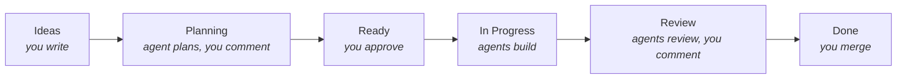

---

title: Development flow
description: How issues move across the board and where you step in.
slug: workflow
---

# Development flow

You own the board. Agents do the work in between.

## 1. Ideas

Write issues. Use the **User need** or **Technical task** issue template, or talk the idea through with your agent and let it file the issue. See [Capturing ideas](./09-capturing-ideas.md). Nothing runs here.

## 2. Planning

Move a card here to get a plan. The `planner` writes the plan into the issue body and sets a `type:*` label.

Comment on the issue to steer it. Each round, the planner answers every new comment and updates the plan. It can also split work into new issues or sub-issues when you ask.

## 3. Ready

Moving a card to Ready approves the plan. Cards are picked top-down, in the project's manual item order.

## 4. In Progress

An implementer builds the plan on branch `kanbot/<issue>` in its own worktree, commits, and the daemon opens a PR. The `type:*` label picks the implementer. When all PRs are open, the card moves to Review.

If the agent reports it is blocked, you get a notification.

## 5. Review

Each PR goes through, in order:

1. **Your feedback.** Comments and review threads from you are handled first, by the `fixer`.
2. **Merge conflicts.** If the base branch moved and the PR no longer merges, the `fixer` merges the base branch in and resolves the conflicts. It tries up to 3 times. Then the issue gets `needs-human`.
3. **Failing CI.** The `fixer` tries up to 3 times. Then the issue gets `needs-human`.
4. **Code review** by `reviewer-code`, then a fix if it found problems.
5. **Spec review** by `reviewer-spec`, then a fix if it found problems.
6. **Copilot review**, if you turned it on. The `fixer` answers its comments. See [Copilot review](./10-copilot-review.md).

Nits don't trigger a fix. When all passes are clean, the PR gets `agent-reviewed` and you get a "Ready to test" notification.

Comment on the PR or start a review thread any time. An agent answers and pushes a fix.

Conflicts are checked even after a PR is `agent-reviewed`. So if you push to the base branch yourself, or merge another PR, open kanbot PRs are kept mergeable. Kanbot merges rather than rebases, so history on the PR branch is never rewritten.

## 6. Done

You test and merge. The board's built-in workflow moves the card to Done, and kanbot cleans up worktrees.

## Exploring alternatives

Add `explore:2`, `explore:3` or `explore:4` to an issue before planning. The plan then has N approaches, and N agents build them as N PRs (`kanbot/<issue>-v<k>`). When all are agent-reviewed, kanbot posts a comparison and notifies you. Merge one; a GitHub workflow closes the others.

## When agents give up

A job that fails `maxAttempts` times labels the issue `needs-human`. Fix the cause, then remove the label to retry.

## Who can steer

Only collaborators with write access can steer agents. Comments from others are ignored.

## Safety

- Agents never get a GitHub token. The daemon makes every comment, push and PR.
- `gh`, `git push`, `git remote` and `git config` are denied for agents.
- GitHub is the only state. You can stop and restart the daemon any time.

Workers run as your user, and commands are blocked by pattern, not missing credentials. A determined prompt injection could get around that.
